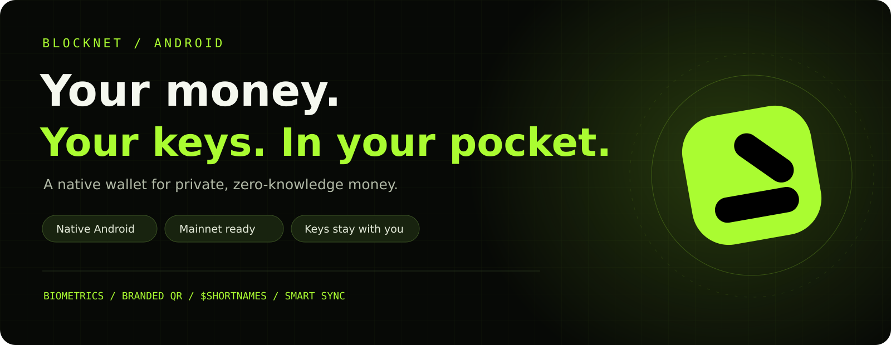
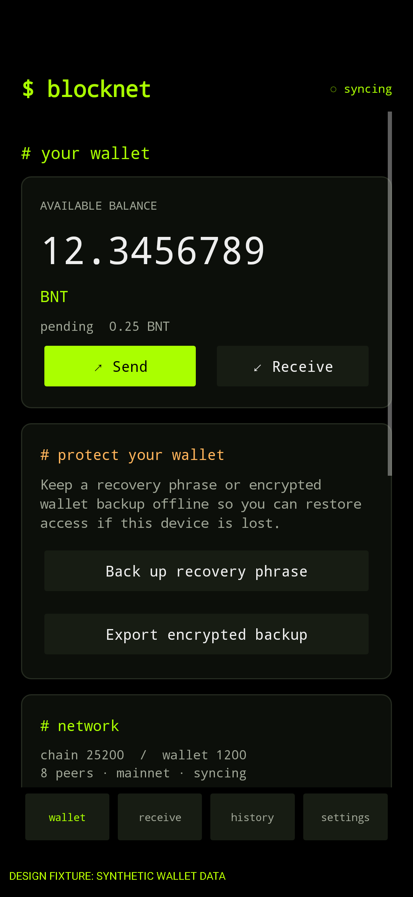
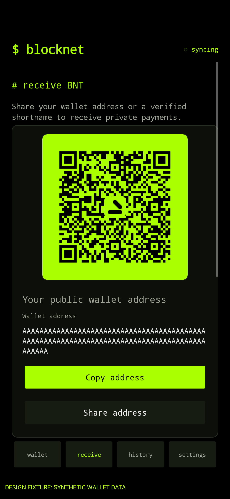
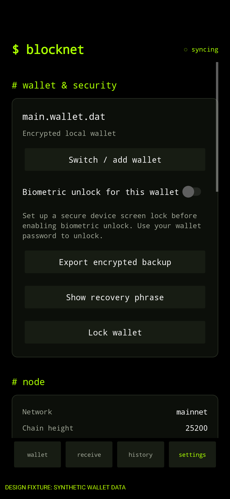

  
  
  
  

# Blocknet Android Wallet

Native Android wallet for Blocknet mainnet, using Blocknet Core and Mantle.

> [!CAUTION]
> **Existing preview wallet? Verify recovery before changing APKs.** Earlier
> preview APKs used disposable signing certificates. Android cannot install an
> APK signed with the new owner certificate over one of those builds. **Do not
> uninstall your current wallet or clear its app data to make an update work.**
> First verify that you can restore on a separate device or Android profile.
> Phrase-created wallets need the recovery phrase. Wallets imported from
> spend/view keys have **no recovery phrase**; keep the original keys or an
> encrypted wallet backup **and its password**. Losing every usable recovery
> copy can permanently lose access to your coins. Read the
> [migration warning](android/docs/OWNER_RELEASE_NOTES.md) before installing.

<a href="https://github.com/crappyrules/blocknet-android/releases"><strong>Download the Android preview APK →</strong></a>

## Private money. Native experience.

<table>
  <tr>
    <th>Your wallet, at a glance</th>
    <th>Receive with a scan</th>
    <th>Security in your hands</th>
  </tr>
  <tr>
    <td align="center"></td>
    <td align="center"></td>
    <td align="center"></td>
  </tr>
  <tr>
    <td>Balances, sync progress and recovery tools in one place.</td>
    <td>Branded payment QR codes, sharing and verified shortnames.</td>
    <td>Optional biometric unlock, encrypted backups and seed recovery.</td>
  </tr>
</table>

*Screenshots are app-rendered design fixtures with synthetic wallet data; shown balances and addresses are examples.*

| Feature | What you can do |
| --- | --- |
| **Keys on your phone** | Create or restore an encrypted wallet; import private keys or a view-only account. |
| **Faster recovery entry** | Tap offline word suggestions while typing your seed phrase. |
| **Biometric unlock** | Unlock with supported strong biometrics using Android Keystore protection. |
| **Send by shortname** | Resolve signed Blocknet ID `$shortnames` and review the destination before sending. |
| **Scan and share** | Use Blocknet-branded QR codes and payment requests with optional amount and memo. |
| **Control your connection** | Choose Wi-Fi-only sync or allow mobile data; bootstrap with bundled mainnet checkpoints. |
| **Stay informed** | Receive transaction notifications with optional sound; open hashes in the explorer. |

Locked-wallet alerts require the **activity** Core build and opening the wallet once after each node restart.

## Build, install and explore

- [Build and setup](android/README.md)
- [Acceptance results](android/docs/ACCEPTANCE.md)
- [Core build instructions](android/docs/CORE_ANDROID_BUILD.md)
- [Download APKs from Releases](https://github.com/crappyrules/blocknet-android/releases)
- [Browse CI builds and test reports](https://github.com/crappyrules/blocknet-android/actions/workflows/android.yml)

The `android-test` directory contains the supplied ARM64 build inputs.

## GitHub Actions APK builds

[Build Android APK](https://github.com/crappyrules/blocknet-android/actions/workflows/android.yml)
runs on pushes to `master`, pull requests, version tags, and manual **Run workflow** requests.
The ordinary run tests, lints, builds and verifies two ARM64 debug APK variants:

- **activity**: rebuilds the pinned Core source with the reviewed activity and
  signed announcement patches; supports transaction alerts while a loaded
  wallet is locked.
- **supplied**: packages the original supplied Core unchanged as a compatibility
  fallback.

Open a successful run and download the desired APK artifact under **Artifacts**.
Each includes a debug APK, checksum and build provenance. CI debug APKs use disposable signing
keys and are only for testing. A version tag does **not** publish a release.
Owner signing and publication are separate manual jobs protected by GitHub
environment approvals and tag checks. No private signing key is in this repository.
See the [release process](android/docs/CI_RELEASE.md) and
[migration warning](android/docs/OWNER_RELEASE_NOTES.md) before using an APK.

CI does not run a node, access wallets, or perform funded transactions. Device acceptance
results and remaining physical checks are documented in `android/docs/ACCEPTANCE.md`.
